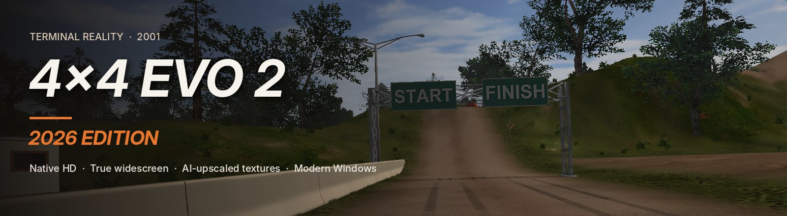
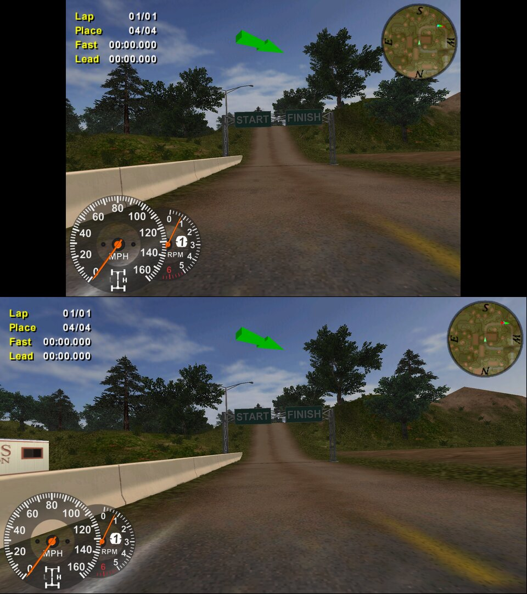
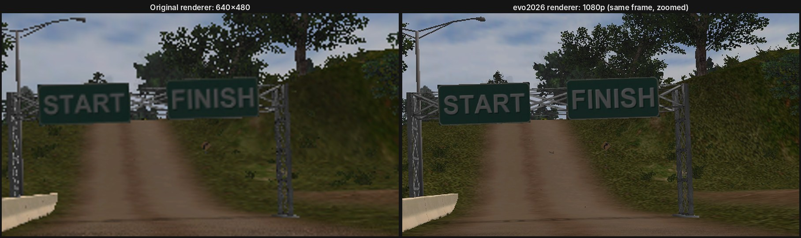
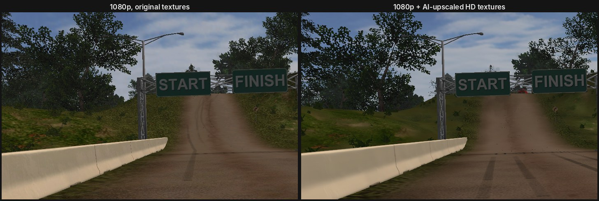
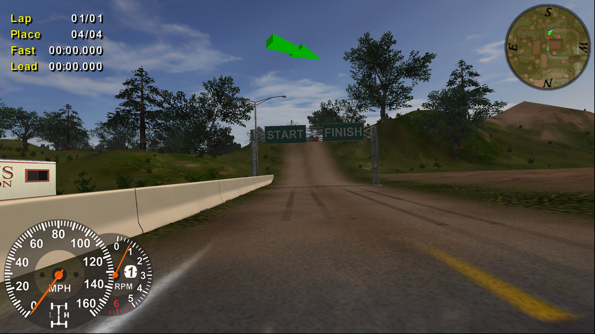
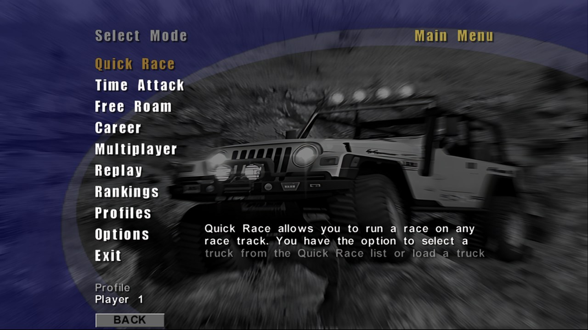
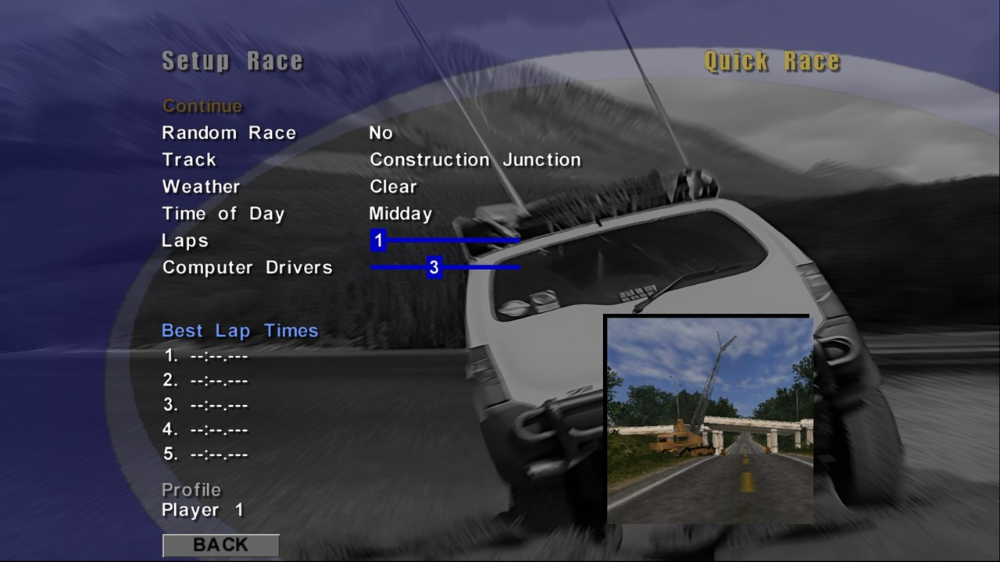
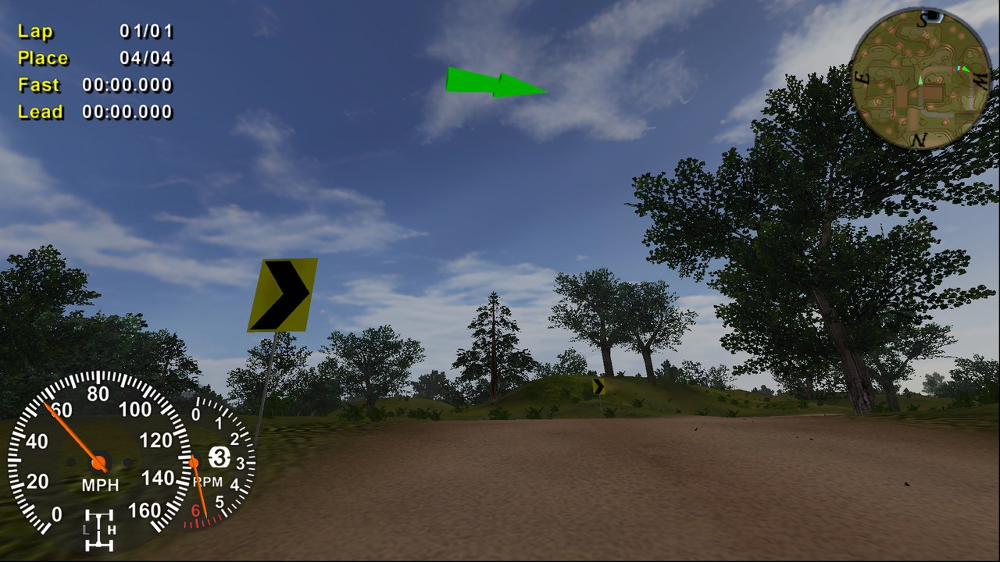
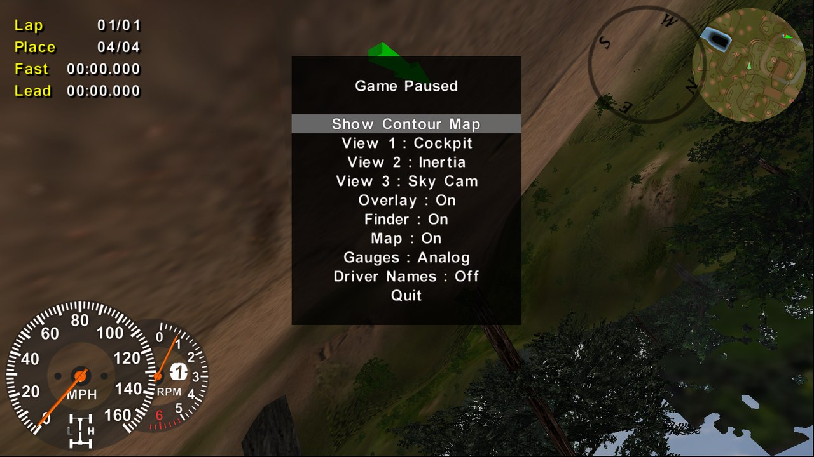

# 4x4 Evo 2: 2026 Edition

**4x4 Evo 2** is the off-road racing game Terminal Reality released in 2001 for Windows, Mac, PlayStation 2, Xbox and GameCube. This project brings the PC version (Build 139) to modern Windows in native HD and true widescreen, the same way [4x4 Evolution: 2026 Edition](https://github.com/antonflor/4x4-Evo-2026-Recomp) does for the first game.

The heart of it is **evo2026**, a drop-in Direct3D 9 renderer for the game. You don't need to modify the game's exe on disk. It adds:

- native-resolution output (1080p, 1440p, 4K) in a borderless window
- true widescreen (Hor+), with the race HUD moved to the screen edges
- 16× anisotropic filtering, vsync
- a full HD texture pack: all 30,502 of the game's textures, AI-upscaled 4×
- texture tools to export, upscale and pack the game's textures yourself

Built on the open-source [4x4e](https://github.com/americusmaximus/4x4e) Direct3D 9 renderer (MIT).

## Screenshots

All screenshots are at 1920×1080.

### Widescreen

The extra width shows more of the track at the sides. Nothing is stretched, and the HUD moves out to the edges.



### Native resolution

The same view as the original Direct3D 8 renderer draws it at 640×480, and as evo2026 draws it at 1080p (zoomed in).



### HD textures

The original textures next to the AI-upscaled HD pack.



### In game



<table>
  <tr>
    <td></td>
    <td></td>
  </tr>
  <tr>
    <td align="center">Main menu</td>
    <td align="center">Quick Race setup</td>
  </tr>
  <tr>
    <td></td>
    <td></td>
  </tr>
  <tr>
    <td align="center">On the track</td>
    <td align="center">Pause menu</td>
  </tr>
</table>

## Layout

| Path | What it is |
|---|---|
| `renderer/` | Renderer source (C++20, MinGW-w64 i686) |
| `tools/` | `is5_extract.py` (unpack the disc's InstallShield cabinet), `pod_textures.py` (export textures from the PODs), `upscale_textures.py` (Real-ESRGAN), `optimize_textures.py` (opaque textures to JPEG), `make_texture_pack.bat` (all three in one go), `make_payload.sh` (installer payload from your disc), `traceproxy/` (renderer call tracer) |
| `dist/` | User kit: README, `install.ps1` / `uninstall.ps1` |
| `docs/` | `FINDINGS.md` (reverse-engineering notes for the Evo 2 exe), release notes, the screenshots on this page |
| `installer/` | Inno Setup script and artwork for the all-in-one installer (game files not included) |

Full documentation, settings and the texture workflow: [`dist/README.md`](dist/README.md).

## Build

```
make            # needs i686-w64-mingw32-g++ (Linux/WSL: apt install g++-mingw-w64-i686)
```

Output: `build/evo2026.dll`, installed into the game folder as `tridx8.dll`.

## Releases

Each release carries the built DLL kit, the HD texture pack (`textures-hd-01..15.zip`) and the all-in-one installer (`4x4Evo2-2026-Setup.exe` plus its `-N.bin` slices: download them all into one folder, then run the exe).

The installer contains game files from a personal copy of the game, so this repository must stay **private**.
