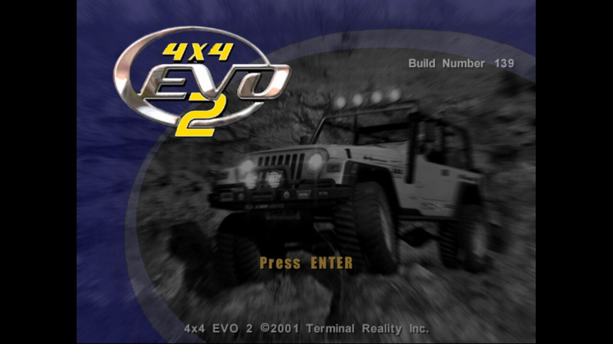

# 4x4 Evo 2: 2026 Edition

**4x4 Evo 2** is Terminal Reality's 2001 off-road racer. This project brings the PC version (Build 139) to modern Windows in native HD and true widescreen, the same way [4x4 Evolution: 2026 Edition](https://github.com/antonflor/4x4-Evo-2026-Recomp) does for the first game.

The renderer here is a fork of that project's **evo2026** Direct3D 9 renderer (itself built on the MIT-licensed [4x4e](https://github.com/americusmaximus/4x4e)). Evo 2 loads its graphics from a plug-in DLL picked by name in `system\METAL.INI`, so the renderer drops in as `tridx8.dll`. You don't need to modify the game's exe on disk.

## Status

| | |
|---|---|
| Boots, menus, races at native resolution | ✅ works (unmodified Evo 1 renderer, first test) |
| True widescreen (Hor+) + HUD at the edges | ✅ works in races |
| Foliage alpha edges, blend modes | ✅ fixed (setAlphaRef / setSrcBlend / setDestBlend) |
| Widescreen menu layouts (backgrounds are stretched for now) | ⏳ planned |
| HD texture pack | ✅ starter pack: UI, trucks, drivers, Construction Junction (full pack: `tools/make_texture_pack.bat` on a GPU) |
| All-in-one Windows installer | ✅ Inno Setup (`installer/`) |

### Widescreen

Top: 4:3 with side bars. Bottom: true 16:9, with more of the track at the sides and the HUD at the screen edges.


## Layout

- `renderer/`: the Direct3D 9 renderer (builds `evo2026.dll`, installed as `tridx8.dll`)
- `tools/is5_extract.py`: extracts the game files from the disc's InstallShield 5 `data1.cab`
- `tools/pod_textures.py`, `tools/upscale_textures.py`: texture export and AI upscaling
- `docs/FINDINGS.md`: reverse-engineering notes for the Evo 2 exe

## Build

```
make            # needs i686-w64-mingw32-g++ (MinGW-w64)
```

This repo contains no game files. You need your own 4x4 Evo 2 disc.
